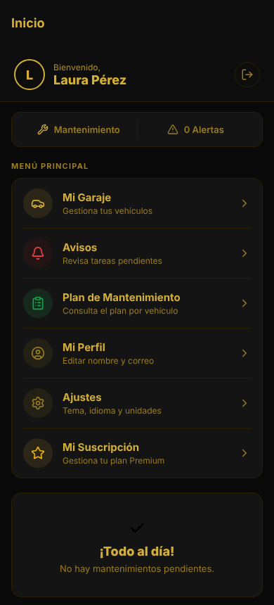
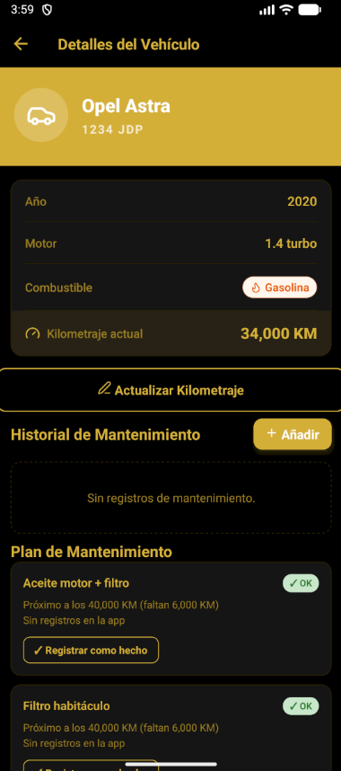
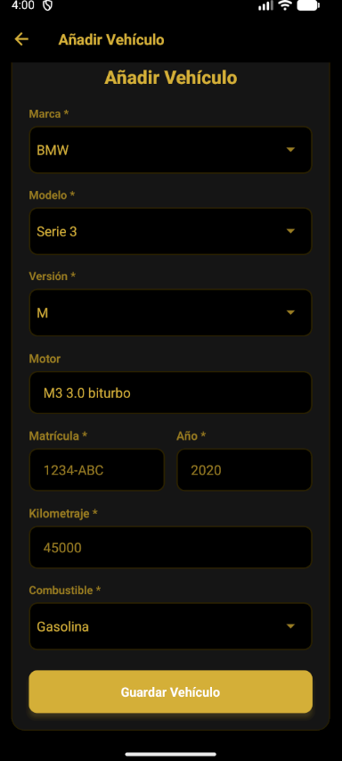
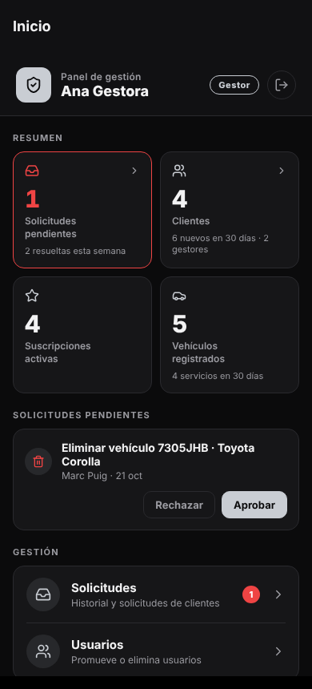
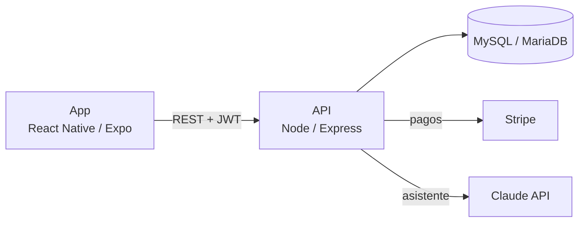

<p align="center">
  
</p>

<h1 align="center">AutoControl</h1>

<p align="center">
  App multiplataforma de mantenimiento de vehículos para talleres y sus clientes.<br/>
  React Native (Expo) · Node.js / Express · MySQL / MariaDB · Stripe · Claude API
</p>

---

## Qué es

AutoControl permite a los clientes de un taller registrar sus coches, llevar el historial de mantenimiento y recibir avisos de lo que toca revisar según el **plan de fábrica** de su marca, modelo y versión. Los **gestores** del taller administran usuarios y aprueban las acciones sensibles antes de que se apliquen.

Funciona en **Android** y en **web** con el mismo código.

## Capturas

<p align="center">
  
  
  
  
  
  
</p>

<p align="center"><sub>Inicio · Mi garaje · Ficha y plan de mantenimiento · Alta de vehículo · Avisos · Panel del gestor</sub></p>

## Funcionalidades

- **Garaje del cliente**: alta de vehículos, actualización de kilometraje e historial de servicios.
- **Planes de mantenimiento de fábrica**: operaciones por marca/modelo/versión con intervalos en km y meses, y un botón "Registrar como hecho" que recalcula el siguiente aviso.
- **Avisos de mantenimiento**: qué está vencido o próximo, calculado a partir del último registro o del kilometraje con el que se dio de alta el coche.
- **Fluidos recomendados** y ficha técnica de cada vehículo.
- **Roles cliente / gestor** con flujo de aprobación: borrar un coche o cambiar datos de perfil crea una solicitud que un gestor aprueba o rechaza. La aprobación se ejecuta dentro de una transacción.
- **Panel propio para el gestor**: resumen del taller (solicitudes pendientes, clientes, suscripciones activas, vehículos y servicios recientes) y aprobación o rechazo de solicitudes desde el propio inicio.
- **Gestión de usuarios** para gestores: promover clientes a gestor y eliminar usuarios (clientes u otros gestores) junto con todos sus datos.
- **Suscripción de pago con Stripe**, validada en el servidor (estado del pago, usuario, plan e importe) y con muro de pago aplicado en la API.
- **Asistente con IA** (Claude API) para preguntas sobre el coche.

## Stack

| Capa | Tecnología |
|---|---|
| Frontend | React Native 0.81, Expo SDK 54, React Navigation, Axios, AsyncStorage |
| Backend | Node.js, Express, JWT + bcrypt, mysql2 (SQL sin ORM) |
| Base de datos | MySQL / MariaDB |
| Pagos | Stripe (PaymentSheet en Android, Stripe.js en web) |
| IA | Anthropic SDK (Claude) |
| Tests | Jest + Supertest |



## Seguridad

- **Rol actualizado en cada petición**: el middleware de autenticación vuelve a cargar el usuario desde la base de datos, así que una promoción o un borrado tienen efecto al momento.
- **Registro público solo como cliente**: nadie puede registrarse como gestor.
- **Pagos verificados contra Stripe**: cada pago solo se puede usar una vez.
- **Propiedad comprobada en el servidor**: cada endpoint verifica que el recurso es del usuario.
- **Validación de entradas**: km, años, fechas y emails.
- **Rate limiting**: en login y registro, en el asistente y un límite general por IP.
- **CORS restringido**: solo se aceptan los orígenes configurados.
- **Errores genéricos al cliente**: el detalle solo se registra en el servidor.

## Estructura

```
backend/
  src/
    controllers/   lógica de cada recurso
    routes/        rutas /api/*
    models/        acceso a datos (SQL)
    middleware/    autenticación, roles, suscripción, rate limiting
    utils/         validación
  database/        schema, seeds y migraciones
  tests/           tests de API (Jest + Supertest)
frontend/
  src/
    screens/       pantallas de la app
    components/    componentes reutilizables
    services/      cliente de la API
  android/         proyecto nativo Android
docs/
  architecture.md  arquitectura, modelo de datos y endpoints
```

## Puesta en marcha

### Requisitos

- Node.js 18 o superior
- MariaDB (por ejemplo, con XAMPP) o MySQL
- Android Studio con un emulador, para la versión Android

### 1. Base de datos

```bash
mysql -u root -e "CREATE DATABASE car_maintenance_app"
mysql -u root car_maintenance_app < backend/database/schema.sql
mysql -u root car_maintenance_app < backend/database/seed.sql
mysql -u root car_maintenance_app < backend/database/car_fluids.sql
mysql -u root car_maintenance_app < backend/database/seed_maintenance_plans.sql
```

Más detalles, migraciones y cómo crear el primer gestor en [`backend/database/README.md`](backend/database/README.md).

### 2. Backend

```bash
cd backend
cp .env.example .env    # rellena DB_*, JWT_SECRET, STRIPE_SECRET_KEY y CLAUDE_API_KEY
npm install
npm run dev             # http://localhost:5000
npm test                # tests
```

### 3. Frontend

```bash
cd frontend
cp .env.example .env    # opcional: URL de la API y clave publicable de Stripe
npm install
npx expo start --web    # versión web
npx expo run:android    # versión Android (emulador o móvil)
```

## Documentación

- [Arquitectura, modelo de datos y endpoints](docs/architecture.md)
- [Próximas mejoras](docs/PENDIENTES.md)

## Autor

**Franco Viera Ottonelli**: [GitHub](https://github.com/FrancoVieraOttonelli2000)
