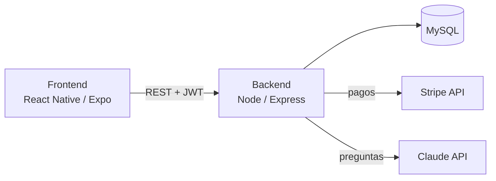
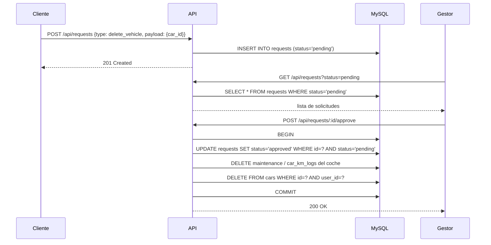
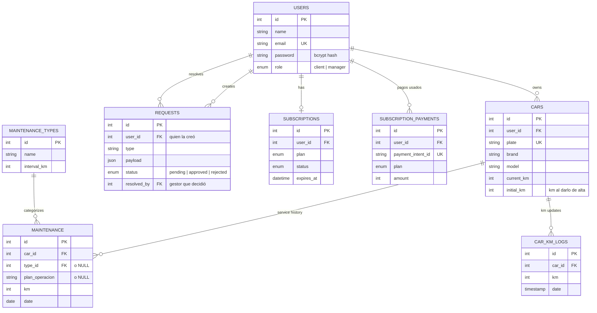

# Arquitectura — AutoControl (car_maintenance_app)

## Resumen

AutoControl es una app de mantenimiento de vehículos con dos roles: **clientes**,
que registran sus coches y llevan el historial de mantenimiento, y
**gestores**, que administran usuarios y aprueban acciones sensibles (borrar
un vehículo, editar datos de perfil) antes de que se apliquen. Incluye
suscripción de pago vía Stripe y un asistente de coche impulsado por la API de
Claude.

## Componentes

- **Frontend** — React Native (Expo), navegación con `@react-navigation/native-stack`.
  La pantalla de inicio (`HomeScreen`) muestra un panel distinto según el rol:
  `ManagerHomeScreen` (resumen, solicitudes pendientes con aprobar/rechazar,
  gestión) para gestores y `ClientHomeScreen` (garaje, avisos, plan) para clientes.
  Guarda el JWT y los datos básicos del usuario (`id`, `name`, `email`, `role`)
  en `AsyncStorage` tras el login/registro.
- **Backend** — Node.js / Express. Autenticación con JWT (`jsonwebtoken` +
  `bcrypt`), autorización por rol vía middleware. Un único proceso expone
  todas las rutas bajo `/api/*`.
- **Base de datos** — MySQL (vía `mysql2/promise`, pool de conexiones en
  `backend/src/config/database.js`).
- **Servicios externos** — Stripe (suscripciones), Anthropic/Claude API
  (asistente de coche, respuestas cortas sobre ficha técnica/mods).

## Diagrama de componentes

## Autenticación y roles

- El registro público (`POST /api/auth/register`) siempre crea usuarios con
  `role: 'client'` — el campo `role` del body se ignora a propósito, nadie
  puede auto-registrarse como gestor.
- El primer gestor se promueve a mano en la base de datos (`UPDATE users SET
  role = 'manager' WHERE email = '...'`). A partir de ahí, cualquier gestor
  puede promover a otros usuarios vía `POST /api/managers/promote`.
- Un gestor puede borrar a cualquier usuario, cliente o gestor, con
  `DELETE /api/managers/users/:id`, pero no a sí mismo (así nunca se queda la
  app sin gestores). El borrado se hace en una transacción: historial y km de
  sus coches, coches, sus solicitudes, pagos, suscripción y el usuario. Las
  solicitudes de otros usuarios que hubiera resuelto se conservan con
  `resolved_by = NULL`. Su token deja de valer al momento, porque `protect`
  ya no lo encuentra en la base de datos.
- El JWT incluye `{ id, role }`, pero el middleware `protect` vuelve a cargar
  el usuario desde la base de datos en cada petición: el rol que cuenta es
  siempre el actual (una promoción vale al momento y un usuario borrado deja
  de tener acceso). `requireManager` (después de `protect`) exige
  `role === 'manager'`.
- `GET /api/auth/me` devuelve los datos actuales del usuario. La app lo usa al
  arrancar para recuperar la sesión sin pedir login, y en la pantalla de
  inicio para refrescar nombre/email tras un cambio aprobado.
- Login y registro tienen un límite de 10 intentos cada 15 minutos por IP y
  email (`middleware/rateLimit.js`).

## Suscripción y muro de pago

- El muro de pago se aplica en el servidor: `requireSubscription` devuelve
  `402 { code: 'SUBSCRIPTION_REQUIRED' }` en coches, mantenimiento, avisos,
  planes, fluidos y asistente si el cliente no tiene una suscripción activa.
  Los gestores no la necesitan. La app redirige a la pantalla de suscripción
  al recibir un 402 (interceptor de axios en `services/api.js`).
- `POST /api/subscriptions/activate` solo recibe el `paymentIntentId`. El
  servidor lo consulta en Stripe y comprueba que esté pagado, que sea de ese
  usuario (`metadata.user_id`), que el importe y la moneda sean los del plan, y
  toma el plan de `metadata.plan` (no del body). Cada pago se guarda en
  `subscription_payments` con UNIQUE, así que no se puede reutilizar.
- Renovar antes de que caduque suma los meses a la fecha de caducidad actual.

## Flujo de solicitudes (cliente → gestor)

Borrar un vehículo o editar datos de perfil (`name`/`email`) no se ejecuta
directo: el cliente crea una solicitud (`requests`, `status: pending`), y un
gestor la aprueba o rechaza. Al aprobar, el backend ejecuta el cambio real
dentro de una transacción (si falla la ejecución, se revierte también el
cambio de estado de la solicitud).

Al crear la solicitud ya se valida: el coche tiene que ser del usuario (y no
puede haber otra solicitud de borrado pendiente para él); el email nuevo tiene
que ser válido y no estar en uso. La solicitud de borrado guarda una copia de
matrícula/marca/modelo para que el gestor vea qué se borra. Si al aprobar el
cambio ya no se puede aplicar (el coche no existe, el email se ocupó), la
solicitud se marca como rechazada con una nota y se devuelve 409. La
aprobación "reserva" la solicitud con `UPDATE ... WHERE status = 'pending'`,
así dos gestores no pueden aplicarla dos veces.

No existe una ruta `DELETE /api/cars/:id` pública — el único camino para
borrar un coche es este flujo. `carController.js`/`Car.js` sí exponen el
método de borrado a nivel de modelo, pero solo lo invoca `approveRequest`
internamente.

## Modelo de datos

`maintenance_plans` (catálogo de fábrica de km/meses por marca-modelo-versión)
y `car_fluids` no aparecen en el diagrama porque no dependen de un usuario —
son tablas de referencia compartidas, consultadas por marca/modelo/versión.

**Nota sobre integridad referencial**: la sintaxis inline
`columna INT REFERENCES otra_tabla(id)` usada en `schema.sql` se comporta
distinto según el motor: MySQL y MariaDB ≤ 10.4 (la de XAMPP) la ignoran,
pero MariaDB 10.5+ la convierte en una clave foránea real. Por eso el borrado
de un coche elimina primero su historial (`maintenance`, `car_km_logs`) y
después el coche: funciona en los dos casos. Las comprobaciones de propiedad
se siguen haciendo en los controllers.

## Avisos de mantenimiento

Hay dos sistemas que conviven:

- **Genérico** (`maintenance_types`, `/api/alerts`): cinco tipos con un
  intervalo en km.
- **Plan de fábrica** (`maintenance_plans`, `/api/maintenance-plans/alertas-car/:carId`):
  operaciones por marca/modelo/versión con `cada_km`, `cada_meses` y
  `primera_vez_km`.

Un registro de `maintenance` es de un tipo genérico (`type_id`) o de una
operación del plan (`plan_operacion`), nunca de los dos. En la ficha del
coche, cada operación del plan tiene un botón "Registrar como hecho".

La pantalla Avisos (`/api/alerts`) y los inicios de cliente y gestor usan el
plan de fábrica cuando el coche lo tiene (las operaciones vencidas, lo mismo
que muestra la ficha) y los tipos genéricos solo para coches sin plan. Así el
inicio nunca dice "todo al día" mientras la ficha tiene operaciones vencidas.

Cálculo de cuándo toca algo:

- Si hay registro: el último km registrado + el intervalo (y, si la operación
  tiene `cada_meses`, la fecha del registro + esos meses).
- Si no hay registro: se parte de `cars.initial_km`, el kilometraje con el que
  se dio de alta el coche. Lo que tocaba antes no se sabe si se hizo, así que
  no se marca como vencido; se avisa a partir del siguiente intervalo. (Antes
  se suponía 0 km y un coche usado nacía con todo vencido.)

## Endpoints principales

| Método | Ruta | Auth | Notas |
|---|---|---|---|
| POST | `/api/auth/register` | pública | siempre crea `role: 'client'` |
| POST | `/api/auth/login` | pública | devuelve JWT con `{id, role}`; límite de intentos |
| GET | `/api/auth/me` | autenticado | datos actuales del usuario |
| GET | `/api/cars/user/:userId` | cliente + suscripción | ignora `:userId`, usa el del token |
| POST | `/api/cars` | cliente + suscripción | crea coche propio |
| GET | `/api/cars/:id` | cliente (dueño) + suscripción | 404 si no es tuyo |
| POST | `/api/cars/:id/km` | cliente (dueño) + suscripción | actualiza kilometraje |
| GET | `/api/maintenance/cars/:id/maintenance` | cliente (dueño) + suscripción | historial |
| POST | `/api/maintenance` | cliente (dueño del `car_id`) + suscripción | registra servicio (`type_id` o `plan_operacion`) |
| GET | `/api/alerts/:userId` | cliente + suscripción | ignora `:userId`, usa el propio |
| GET | `/api/maintenance-plans/*` | cliente + suscripción | catálogo compartido + `alertas-car/:carId` (dueño) |
| GET | `/api/car-fluids/:carId` | cliente (dueño) + suscripción | fluidos recomendados |
| POST | `/api/car-assistant/ask` | cliente (dueño del `carId`) + suscripción | consulta a Claude |
| POST/GET | `/api/subscriptions/*` | cliente | Stripe (payment intent, activar, estado); sin muro de pago |
| POST | `/api/requests` | cualquiera autenticado | crear solicitud |
| GET | `/api/requests` | gestor | listar (filtro `?status=`) |
| POST | `/api/requests/:id/approve` | gestor | ejecuta el cambio real, en transacción |
| POST | `/api/requests/:id/reject` | gestor | solo cambia estado, no ejecuta nada |
| POST | `/api/managers/promote` | gestor | promueve a otro usuario por email |
| GET | `/api/managers/stats` | gestor | cifras del panel: usuarios, suscripciones activas, coches, solicitudes, servicios |
| GET | `/api/managers/users` | gestor | lista todos los usuarios |
| DELETE | `/api/managers/users/:id` | gestor | borra un cliente u otro gestor con todos sus datos; no a sí mismo |

## Decisiones y trade-offs

- **Sin ORM** — todo es SQL directo con `mysql2`. Explícito y sin sorpresas,
  a costa de más código repetitivo en cada modelo.
- **Un solo repo con `frontend/` y `backend/`**, sin monorepo tooling —
  razonable al tamaño actual del proyecto.
- **Errores genéricos al cliente, log completo en servidor** — todos los
  `catch` de los controllers devuelven un mensaje fijo y loguean el error real
  con `console.error`, para no filtrar detalles internos (mensajes de Stripe,
  Anthropic o mysql2) a un usuario autenticado.
- **Ownership check a nivel de controller, no de base de datos** — cada endpoint
  que toca un recurso de un usuario (`cars`, `maintenance`, `alerts`,
  `maintenance-plans/alertas-car`, `car-fluids`) valida explícitamente
  `user_id = req.user.id` en la query o antes de ejecutar la acción.
- **Validación de entrada en el servidor** (`utils/validation.js`): km enteros
  entre 0 y 2.000.000, años razonables, fechas `YYYY-MM-DD` reales y no
  futuras, emails con formato válido. Una matrícula repetida devuelve 409.
- **Límite de peticiones en memoria** (`middleware/rateLimit.js`), sin
  dependencias: login/registro, asistente de Claude (30 consultas/hora por
  usuario) y un límite general de 300 peticiones/minuto por IP. Vale para un
  solo proceso; con varias instancias habría que pasarlo a Redis.
- **CORS** restringido a los orígenes de `CORS_ORIGINS` (por defecto, los de
  Expo web en localhost). La app nativa no envía `Origin` y no le afecta.
