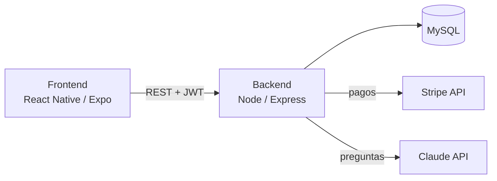
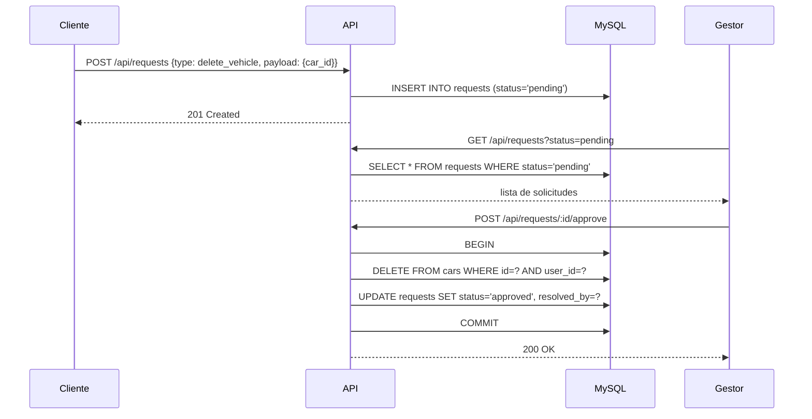
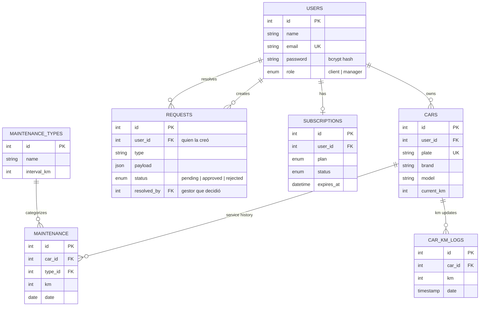

# Arquitectura — AutoControl (car_maintenance_app)

## Resumen

AutoControl es una app de mantenimiento de vehículos con dos roles: **clientes**,
que registran sus coches y llevan el historial de mantenimiento, y
**gestores**, que administran usuarios y aprueban acciones sensibles (borrar
un vehículo, editar datos de perfil) antes de que se apliquen. Incluye
suscripción de pago vía Stripe y un asistente de coche impulsado por la API de
Claude.

## Componentes

- **Frontend** — React Native (Expo), navegación con `@react-navigation/native-stack`.
  Guarda el JWT y los datos básicos del usuario (`id`, `name`, `email`, `role`)
  en `AsyncStorage` tras el login/registro.
- **Backend** — Node.js / Express. Autenticación con JWT (`jsonwebtoken` +
  `bcrypt`), autorización por rol vía middleware. Un único proceso expone
  todas las rutas bajo `/api/*`.
- **Base de datos** — MySQL (vía `mysql2/promise`, pool de conexiones en
  `backend/src/config/database.js`).
- **Servicios externos** — Stripe (suscripciones), Anthropic/Claude API
  (asistente de coche, respuestas cortas sobre ficha técnica/mods).

## Diagrama de componentes

## Autenticación y roles

- El registro público (`POST /api/auth/register`) siempre crea usuarios con
  `role: 'client'` — el campo `role` del body se ignora a propósito, nadie
  puede auto-registrarse como gestor.
- El primer gestor se promueve a mano en la base de datos (`UPDATE users SET
  role = 'manager' WHERE email = '...'`). A partir de ahí, cualquier gestor
  puede promover a otros usuarios vía `POST /api/managers/promote`.
- El JWT incluye `{ id, role }`. El middleware `protect` verifica el token en
  toda ruta autenticada; `requireManager` (encadenado después de `protect`)
  exige `role === 'manager'`.

## Flujo de solicitudes (cliente → gestor)

Borrar un vehículo o editar datos de perfil (`name`/`email`) no se ejecuta
directo: el cliente crea una solicitud (`requests`, `status: pending`), y un
gestor la aprueba o rechaza. Al aprobar, el backend ejecuta el cambio real
dentro de una transacción (si falla la ejecución, se revierte también el
cambio de estado de la solicitud).

No existe una ruta `DELETE /api/cars/:id` pública — el único camino para
borrar un coche es este flujo. `carController.js`/`Car.js` sí exponen el
método de borrado a nivel de modelo, pero solo lo invoca `approveRequest`
internamente.

## Modelo de datos

`maintenance_plans` (catálogo de fábrica de km/meses por marca-modelo-versión)
y `car_fluids` no aparecen en el diagrama porque no dependen de un usuario —
son tablas de referencia compartidas, consultadas por marca/modelo/versión.

**Nota sobre integridad referencial**: en MySQL, la sintaxis inline
`columna INT REFERENCES otra_tabla(id)` usada en `schema.sql` para
`cars.user_id`, `maintenance.car_id`, `car_km_logs.car_id` y `requests.user_id`
**no se aplica como un constraint real** — MySQL la ignora silenciosamente.
Solo `subscriptions.user_id` tiene una `FOREIGN KEY ... ON DELETE CASCADE`
real. La integridad de esas otras relaciones depende del código de la
aplicación (ownership checks en los controllers), no de la base de datos.

## Endpoints principales

| Método | Ruta | Auth | Notas |
|---|---|---|---|
| POST | `/api/auth/register` | pública | siempre crea `role: 'client'` |
| POST | `/api/auth/login` | pública | devuelve JWT con `{id, role}` |
| GET | `/api/cars/user/:userId` | cliente | ignora `:userId`, usa el del token |
| POST | `/api/cars` | cliente | crea coche propio |
| GET | `/api/cars/:id` | cliente (dueño) | 404 si no es tuyo |
| POST | `/api/cars/:id/km` | cliente (dueño) | actualiza kilometraje |
| GET | `/api/maintenance/cars/:id/maintenance` | cliente (dueño) | historial |
| POST | `/api/maintenance` | cliente (dueño del `car_id`) | registra servicio |
| GET | `/api/alerts/:userId` | cliente | ignora `:userId`, usa el propio |
| GET | `/api/maintenance-plans/*` | cliente | catálogo compartido + `alertas-car/:carId` (dueño) |
| GET | `/api/car-fluids/:carId` | cliente (dueño) | fluidos recomendados |
| POST | `/api/car-assistant/ask` | cliente (dueño del `carId`) | consulta a Claude |
| POST/GET | `/api/subscriptions/*` | cliente | Stripe (payment intent, activar, estado) |
| POST | `/api/requests` | cualquiera autenticado | crear solicitud |
| GET | `/api/requests` | gestor | listar (filtro `?status=`) |
| POST | `/api/requests/:id/approve` | gestor | ejecuta el cambio real, en transacción |
| POST | `/api/requests/:id/reject` | gestor | solo cambia estado, no ejecuta nada |
| POST | `/api/managers/promote` | gestor | promueve a otro usuario por email |
| GET | `/api/managers/users` | gestor | lista todos los usuarios |

## Decisiones y trade-offs

- **Sin ORM** — todo es SQL directo con `mysql2`. Explícito y sin sorpresas,
  a costa de más código repetitivo en cada modelo.
- **Un solo repo con `frontend/` y `backend/`**, sin monorepo tooling —
  razonable al tamaño actual del proyecto.
- **Errores genéricos al cliente, log completo en servidor** — todos los
  `catch` de los controllers devuelven un mensaje fijo y loguean el error real
  con `console.error`, para no filtrar detalles internos (mensajes de Stripe,
  Anthropic o mysql2) a un usuario autenticado.
- **Ownership check a nivel de controller, no de base de datos** — como MySQL
  no aplica los `REFERENCES` inline como constraints reales, cada endpoint
  que toca un recurso de un usuario (`cars`, `maintenance`, `alerts`,
  `maintenance-plans/alertas-car`, `car-fluids`) valida explícitamente
  `user_id = req.user.id` en la query o antes de ejecutar la acción.
